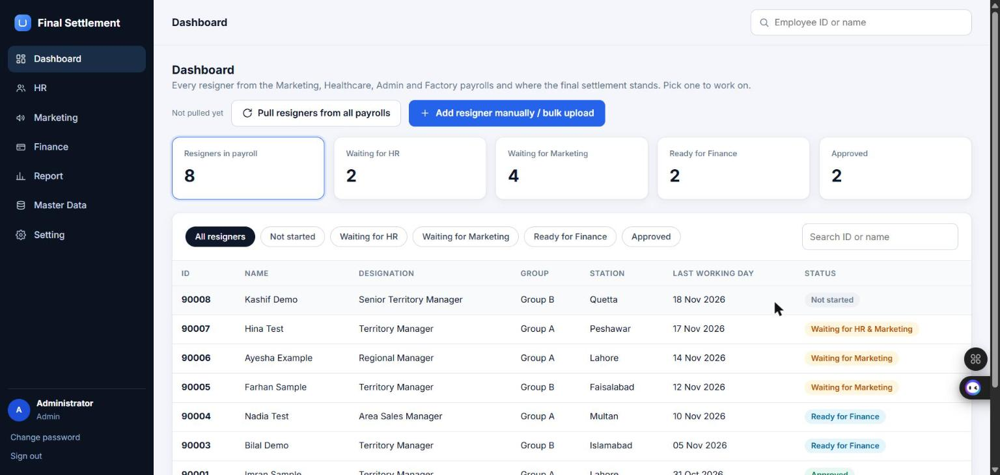
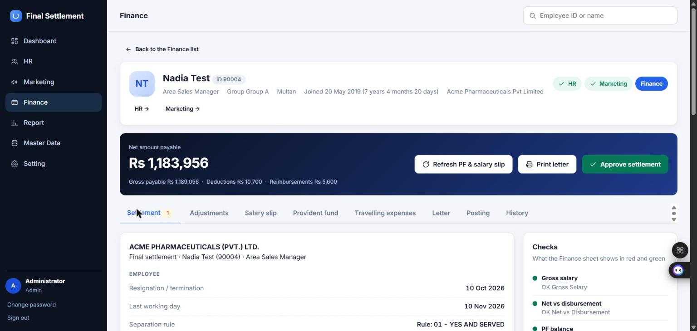
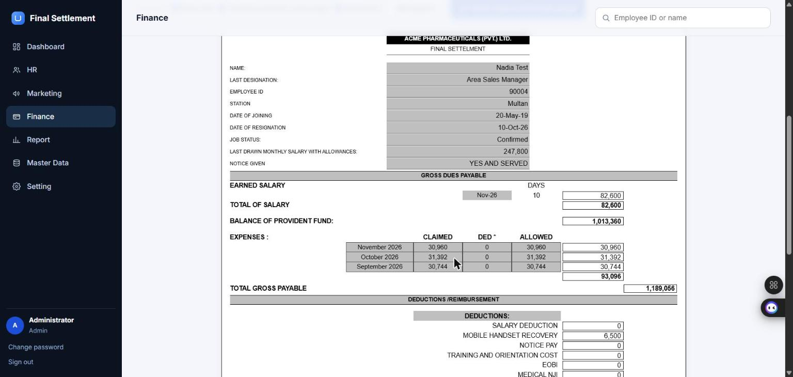
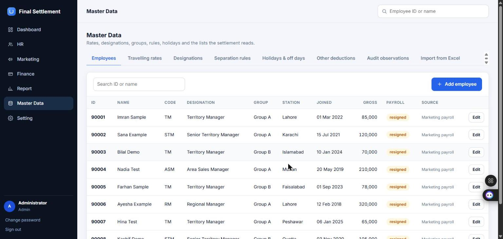
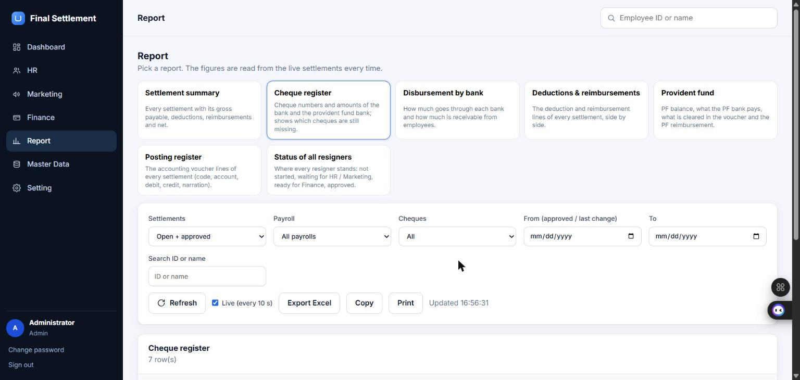

# Updated FSA - Final Settlement

Final-settlement portal for resigning and terminated employees: HR, Marketing and Finance each complete their part, the
engine works out the dues (salary, provident fund, travelling expenses, deductions), and Finance prints the settlement letter.











*All screenshots use made-up demo data (invented company, employees and figures). Every company name, signatory,
bank, ledger code and file path in this repository is a placeholder: set your own in **Setting** and **Master Data**.*

## Try it with demo data

```powershell
$env:UFSA_DATA_DIR = "C:\temp\ufsa-demo"     # an empty folder, so no real data is touched
$env:UFSA_NO_AUTOSETUP = "1"
npm install
node demo/seed.js                            # master data, 8 made-up employees, salary slips, PF balances
npm start                                    # in a second window with the same two variables set
node demo/seed.js http://localhost:4900      # creates settlements at different stages
```
Sign in as `admin` / `admin123` and **change the password straight away** (Change password, bottom left).

Five sections: **HR**, **Marketing**, **Finance**, **Master Data**, **Setting**. One settlement per Employee ID.

```
start:   dist\Start Updated FSA.bat   (opens http://localhost:4900)
first sign-in:  admin / admin123      (change it in the app: Change password)
develop: npm install ; npm start
build:   build-exe.ps1                (close the running exe first)
```

## Where the information comes from
| Needed | Read from | Set in |
|---|---|---|
| Resigners (name, designation, group, station, joining date, last working day, CNIC) | Marketing payroll database (read-only) | Setting > Data sources |
| Provident fund (employee, employer, profit, withdrawal, loan, monthly contributions) | PF portal (signs in as a PF user) | Setting > Data sources |
| Salary slip (gross, notice base, EOBI, medical, audit deduction, status) | Monthly payroll Excel files (sheet "Salary") | Setting > Data sources |
| Rates, designations, groups, rules, holidays, other deductions, audit observations | Master Data (load once from the Finance template) | Master Data > Import from Excel |

## Who does what
* **HR** - resignation / termination date, separation rule, absent deduction.
* **Marketing** - last working date (comes from the payroll), imprest balance (positive = deduction, negative = reimbursement), claim / deduction of KM, Daily, Ex., ON for the last three months.
* **Finance** - everything on the Finance sheet: earned salary, PF, expenses at the rates of the year, deductions, reimbursements, net, bank split, checks, SOP checklist, printable letter, approval (locks the settlement).
* **Master Data** (Finance edits, others read) and **Setting** (administrator).

The calculation is `engine.js`, a port of the Finance sheet.

## Data
SQLite file `ufsa.db` with daily automatic backups (last 14). When this folder is inside OneDrive the data is kept in
`%LOCALAPPDATA%\UpdatedFSA\data` so that OneDrive sync cannot damage the database. Setting > Backup shows the exact path.
The PF portal password is stored in the database (the app has to sign in to the PF portal); use a PF user that can only read.

## Payrolls, slips and bulk upload (added 2026-11-07)
* **Resigners** are pulled from four payroll databases (Setting > Data sources): Marketing, Healthcare, Admin, Factory. Employee IDs are unique across them.
* **Salary slips**: read from the finished runs of the four payroll databases ("Read the slips from the four payroll databases"), from the Excel folder, or from any uploaded Excel file (Setting > Salary slips). Marketing months that have an Excel file keep the Excel slip.
* **Add resigners**: one by one or in bulk (Excel / CSV; template download in the dialog). Existing IDs are skipped and listed.
* **Letter / PDF**: laid out like the Finance sheet and always printed on one A4 page.
* **Data folder**: `..\data` (outside dist), set by `Start Updated FSA.bat`.
